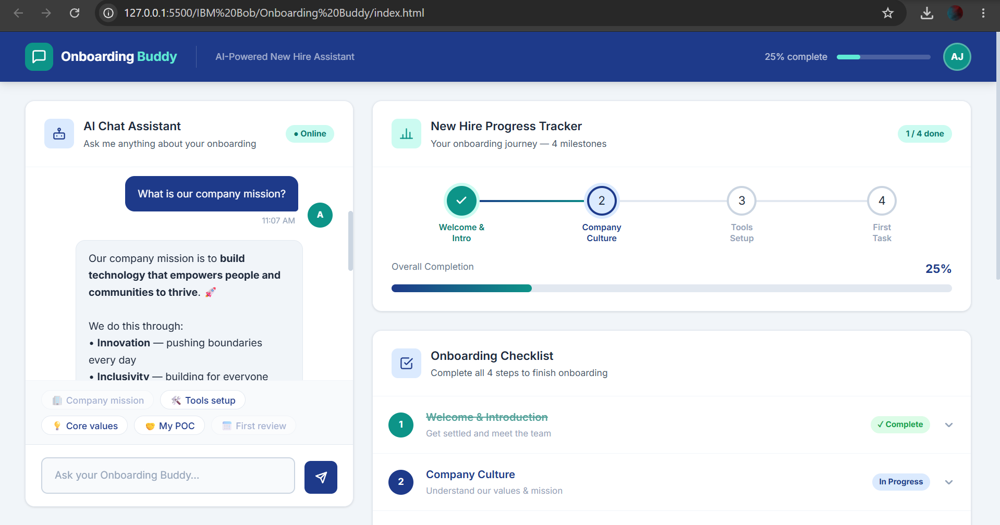
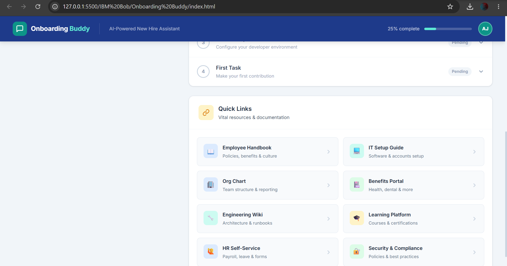

# 🚀 Onboarding Buddy System (AI-Powered New Hire Assistant)

> Capstone Project Track: IBM Bob — AI Builders Challenge

## 📌 Deskripsi Project
**Onboarding Buddy System** adalah aplikasi web interaktif berbasis AI Agent yang dirancang untuk membantu karyawan baru (*new hires*) beradaptasi secara mandiri di minggu pertama kerja. Aplikasi ini menyelesaikan masalah *information overload* dan lamanya waktu adaptasi dengan menyediakan pusat informasi instan, panduan checklist, serta pelacak progres orientasi

---

## 🖼️ Tampilan Antarmuka (Preview)
*(Berikut adalah hasil tangkapan layar dari aplikasi Onboarding Buddy System yang berjalan di browser)*

> 
>  

---

## ✨ Fitur Utama
* **🤖 AI Chat Assistant:** Asisten virtual interaktif dengan sistem perutean kata kunci (*keyword-intent routing*) untuk menjawab FAQ seputar perusahaan, nilai, budaya, dan peralatan kerja
* **✅ Interactive 4-Step Checklist:** Daftar tugas terstruktur (Welcome, Company Culture, Tools Setup, First Task) lengkap dengan sub-tugas dan tombol validasi penyelesaian.
* **🔗 Quick Links Panel:** Akses cepat ke 8 sumber daya penting perusahaan (Handbook, IT Guide, Org Chart, Benefits Portal, dll).
* **📊 Live Progress Tracker:** Bilah pelacak progres milestone secara *real-time* yang terhubung langsung dengan aktivitas checklist pengguna.

---

## 🛠️ Tech Stack
* **HTML5** (Struktur semantik)
* **CSS3** (Sistem desain kustom, palet warna Deep Blue `#1E3A8A` & Teal `#0D9488`, card-based layout)
* **Vanilla JavaScript** (Logika interaktif chat engine & state management checklist)
* *Zero external frameworks or heavy dependencies!*

---

## 🚀 Cara Menjalankan (Run Locally)
1. Clone repository ini ke komputer Anda:
   ```bash
   git clone [https://github.com/rezasyahputra07/onboarding-buddy-system.git](https://github.com/rezasyahputra07/onboarding-buddy-system.git)
